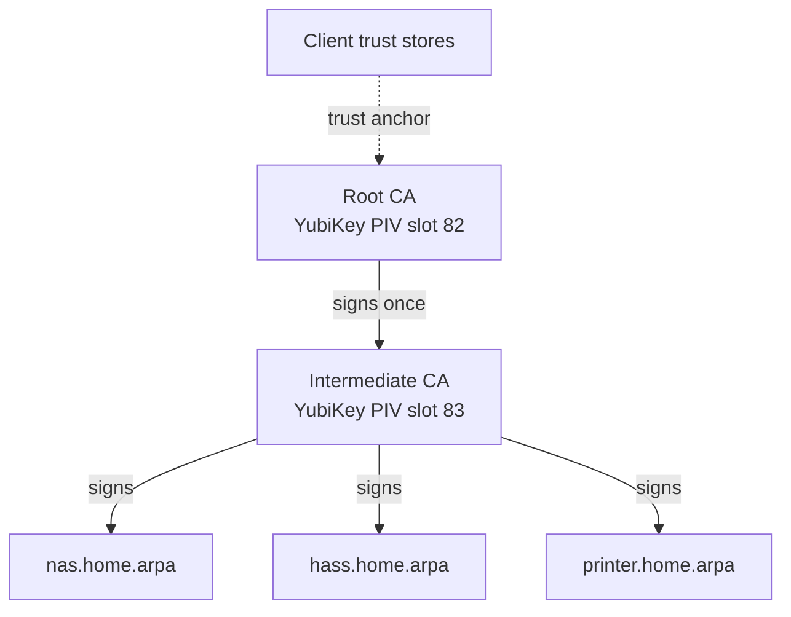
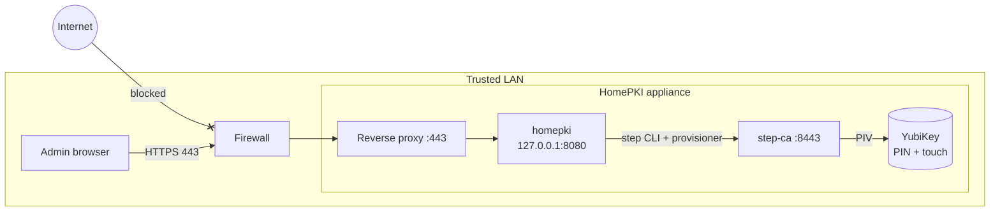
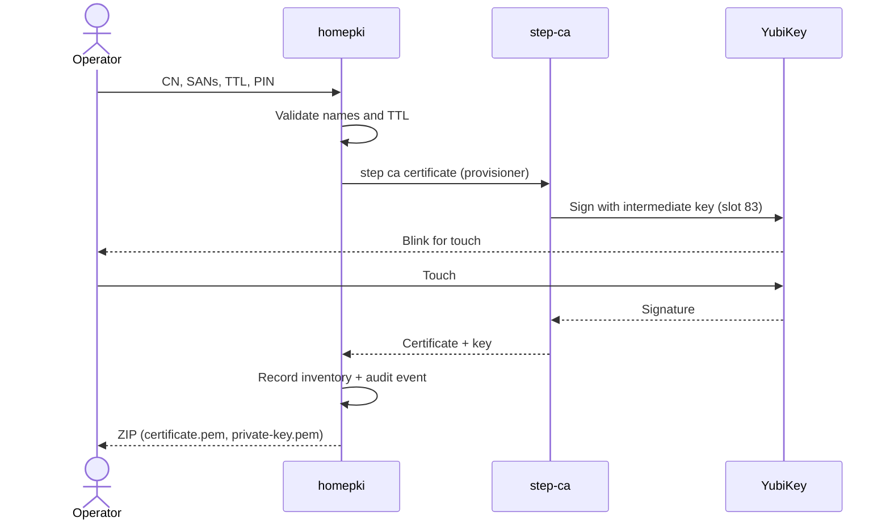
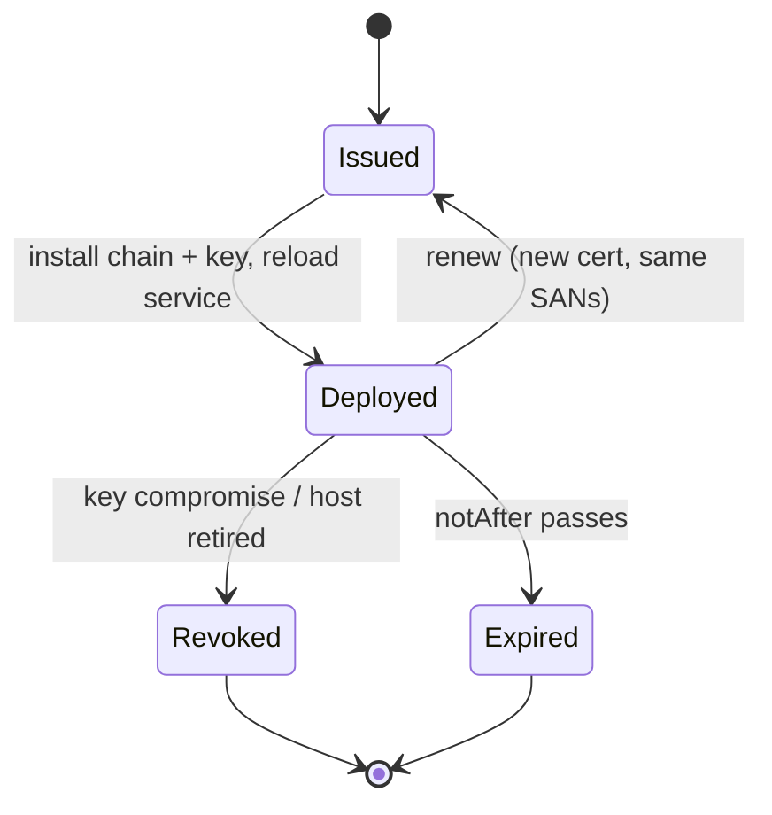

# Running Your Own CA

An operator's introduction to running a private CA: physical security, key handling, certificate profiles, validation, distribution, and lifecycle. It's written for someone comfortable with TLS basics. Concrete examples use HomePKI.

If X.509, chains, and trust stores are new to you, read Smallstep's [Everything you should know about certificates and PKI](https://smallstep.com/blog/everything-pki/) first.

Related docs: `DEVICE_SETUP.md` (installation), `UPGRADE_AND_RECOVERY.md` (backup mechanics).

## Hierarchy

HomePKI provisions a two-tier hierarchy on Step CA. Both CA keys live in YubiKey PIV slots; only the root certificate is distributed to relying parties.



The root signs only the intermediate and is otherwise idle. The intermediate signs leaf certificates. Because clients anchor on the root, the intermediate can be rotated without touching any trust store.

## Physical security and trust boundaries



- **No WAN exposure.** Don't port-forward to the appliance. `homepki` binds to loopback by default; firewall `8080` from the LAN and expose only the proxy. See the firewall section of `DEVICE_SETUP.md`.
- **Keys in hardware.** The YubiKey generates the CA keys on-device; they're non-exportable. HomePKI sets `--pin-policy ALWAYS --touch-policy ALWAYS`, so every signature needs both. The touch policy is the control that matters: a fully compromised host still can't sign without someone physically present.
- **Token custody.** Leaving the YubiKey inserted is acceptable if the appliance is physically out of reach of visitors. Removing it between issuance sessions is stronger.
- **Admin access.** Restrict SSH to key-based login from your admin host. HomePKI v1 has a single local admin account.

## Key material

| Secret | Location in HomePKI | Protection |
|---|---|---|
| Root and intermediate keys | YubiKey PIV slots `82` / `83` (RSA 2048) | Non-exportable; PIN and touch on every use |
| YubiKey PIN / PUK | PIN in `/var/lib/homepki/yubikey-pin` (`0600`), used by `step-ca` | Change from defaults before setup; store the PUK offline, apart from the token |
| Provisioner password | `/etc/homepki/provisioner-password` (`0640 root:homepki`) | Random; authorizes `step ca certificate` and `step ca revoke` |
| Leaf private keys | Only in the issuance ZIP download | Not persisted by HomePKI; lose it and you reissue |

Rules that apply to any CA:

- Generate CA keys where they'll live. HomePKI lets `step ca init` create its usual software keys, then re-keys the CA onto the YubiKey and deletes `secrets/root_ca_key` and `secrets/intermediate_ca_key`. `ca.json` then references `yubikey:slot-id=83`.
- Never move CA key material over email, chat, sync services, or version control.
- Create secret files with restrictive permissions *before* writing to them (`install -m 0600 /dev/null <file>`), as `DEVICE_SETUP.md` does for the provisioner password.

**CSRs.** Best practice is for the subscriber to generate its own key and submit a CSR, so the private key never leaves the host. HomePKI v1 generates the leaf key during issuance and returns it, so the ZIP is a secret: move the key to the service with `scp`, `chmod 600` it, and delete the download. ACME support, planned post-v1, follows the CSR model.

PIN/PUK management and `ykman piv reset`: see Yubico's [ykman PIV commands](https://docs.yubico.com/software/yubikey/tools/ykman/PIV_Commands.html).

## Certificate profiles

| Profile | `basicConstraints` | Key usage / EKU | HomePKI v1 |
|---|---|---|---|
| Root CA | `CA:TRUE` | `keyCertSign`, `cRLSign` | Created at setup |
| Intermediate CA | `CA:TRUE, pathlen:0` | `keyCertSign`, `cRLSign` | Created at setup |
| TLS server | `CA:FALSE` | `digitalSignature`; `serverAuth` | **Issue a certificate** form |
| TLS client (mTLS) | `CA:FALSE` | `digitalSignature`; `clientAuth` | Planned |

Field semantics are defined in [RFC 5280](https://www.rfc-editor.org/rfc/rfc5280). Step CA's default leaf template sets both `serverAuth` and `clientAuth`, so HomePKI v1 leaves carry both.

**Naming.**
- Clients match on SANs; CN is ignored for hostname verification. List every name clients use, including short names.
- HomePKI v1 accepts DNS SANs only, not IP SANs, so give each service a DNS name.
- Avoid wildcards where practical: they share one key across every service they cover.
- Use a subdomain of a domain you own, or `home.arpa` ([RFC 8375](https://www.rfc-editor.org/rfc/rfc8375)). Don't invent TLDs, and don't use `.local` for services, because it's resolved over mDNS ([RFC 6762](https://www.rfc-editor.org/rfc/rfc6762)). HomePKI uses `homepki.local` only for discovering the appliance itself.

**Lifetimes.** A reasonable starting point is a root of 10–20 years, an intermediate of a few years, and leaves of 90 days to 1 year. Public CAs are limited to 398 days for TLS leaves. [Apple applies that limit only to its built-in roots](https://support.apple.com/en-us/102028), not to a root you install yourself, but HomePKI caps leaves at 397 days anyway to stay within it. For the reasoning behind cryptoperiods, see [NIST SP 800-57 Part 1](https://csrc.nist.gov/pubs/sp/800/57/pt1/r5/final).

## Validation



**Before signing.** HomePKI rejects requests that fail these checks:

- CN is present.
- `0 < TTL ≤ 397d`.
- Every name is a valid hostname: at most 253 characters, labels of 1–63 characters from `[A-Za-z0-9-]`, with no leading or trailing hyphen.

Authorization ("should this name be issued to this requester?") is the operator's job until ACME ([RFC 8555](https://www.rfc-editor.org/rfc/rfc8555)) automates proof of control. The touch is your checkpoint: read what you're signing before you touch the YubiKey.

**After signing.**

```sh
step certificate inspect certificate.pem                  # SANs, validity, issuer, EKU
step certificate verify certificate.pem --roots root_ca.crt
grep -c 'BEGIN CERTIFICATE' certificate.pem               # 2 = leaf + intermediate
# Key/cert match: the two hashes must be identical
openssl x509 -in certificate.pem -noout -pubkey | openssl sha256
openssl pkey -in private-key.pem -pubout | openssl sha256
```

**After deploying.** Confirm the service presents the full chain:

```sh
openssl s_client -connect nas.home.arpa:443 -servername nas.home.arpa \
  -CAfile root_ca.crt </dev/null | grep 'Verify return code'
```

A missing intermediate is the most common deployment fault. It produces failures that vary by client. If `certificate.pem` holds only the leaf, append `intermediate_ca.crt` to it.

## Distribution and management

**Distributing the root.** The root certificate is public, but because it's a trust anchor its integrity matters. Verify the fingerprint out of band before installing it:

```sh
step certificate fingerprint /var/lib/homepki/.step/certs/root_ca.crt   # on the appliance
step certificate fingerprint root_ca.crt                                # on the client
```

Platform-specific installation:

- `step certificate install root_ca.crt` installs into the system trust store; the `--firefox` and `--java` flags add those stores. See [step certificate install](https://smallstep.com/docs/step-cli/reference/certificate/install/).
- Firefox: [Setting up certificate authorities in Firefox](https://support.mozilla.org/en-US/kb/setting-certificate-authorities-firefox).
- iOS/iPadOS: [Trust manually installed certificate profiles](https://support.apple.com/en-us/102390). Installing the profile isn't enough; you must also enable full trust.
- Language runtimes and containers (Python `certifi`, Node, Java, distroless images) often ship their own CA bundles and need the root added separately.

HomePKI shows trust guidance for Linux and macOS but doesn't modify client trust stores.

**Leaf lifecycle.**



- **Inventory.** HomePKI records serial, SANs, validity, and revocation status, and logs issuance and revocation to the audit log. It doesn't record *where* each certificate is deployed, so track that yourself.
- **Renewal.** Manual in v1. Reissue and deploy before `notAfter`. For automation patterns on Step CA, see [Smallstep's renewal docs](https://smallstep.com/docs/step-ca/renewal/).
- **Revocation.** HomePKI calls `step ca revoke` with the serial and a reason. By default Step CA uses *passive* revocation: the certificate can no longer be renewed, but it **remains valid until it expires**, and no CRL or OCSP responder is published. Treat revocation as bookkeeping. On compromise, remove and replace the certificate, and rely on short lifetimes. See [Step CA revocation](https://smallstep.com/docs/step-ca/revocation/).

## Backups and CA lifecycle

| What | Where | Back up? |
|---|---|---|
| Inventory, audit log | `/var/lib/homepki/homepki.db` | Yes |
| CA certs, `ca.json` | `/var/lib/homepki/.step/` | Yes |
| YubiKey PIN file | `/var/lib/homepki/yubikey-pin` | Yes (secret) |
| Appliance config, provisioner password | `/etc/homepki/` | Yes (secret) |
| Root and intermediate private keys | YubiKey | **Not possible**: non-exportable |

Archive both directories together, encrypt the archive, and store a copy off-device. Then test the restore: unpack it into a scratch directory, run `sqlite3 homepki.db 'PRAGMA integrity_check;'`, and compare the root fingerprint against your recorded value. The archive procedure in `UPGRADE_AND_RECOVERY.md` currently covers only the database and config; include `.step/` as well.

**The key-backup trade-off.** Non-exportable keys can't be stolen, but they can't be recovered either. The alternative is to generate keys off-token, keep an encrypted offline backup, and import them into the token. That gives you recoverability, but the backup copy then needs protection equal to the token's. HomePKI takes the non-exportable route. **If the YubiKey is lost, damaged, or reset, you have to provision a new CA and redistribute the new root to every client.** Keep a list of every relying party so that re-provisioning is a chore rather than an incident.

| CA event | Action |
|---|---|
| Setup | Change PIN/PUK, record root fingerprint, take first backup, distribute root |
| Intermediate nearing expiry | Issue a new intermediate from the root; reissue leaves as they renew |
| Root nearing expiry | Create a new root well in advance; distribute alongside the old one; retire the old one after leaves migrate |
| Decommission | Remove the root from all trust stores, run `ykman piv reset` (wipes all PIV slots), factory-reset the appliance |

## Further reading

- [Everything you should know about certificates and PKI](https://smallstep.com/blog/everything-pki/) (Smallstep): concepts and terminology
- [Step CA cryptographic protection](https://smallstep.com/docs/step-ca/cryptographic-protection/): KMS, HSM, and YubiKey backends
- [Yubico PIV overview](https://developers.yubico.com/PIV/)
- [RFC 5280](https://www.rfc-editor.org/rfc/rfc5280): X.509 certificate and CRL profile
- [NIST SP 800-57 Part 1](https://csrc.nist.gov/pubs/sp/800/57/pt1/r5/final): key management and cryptoperiods
